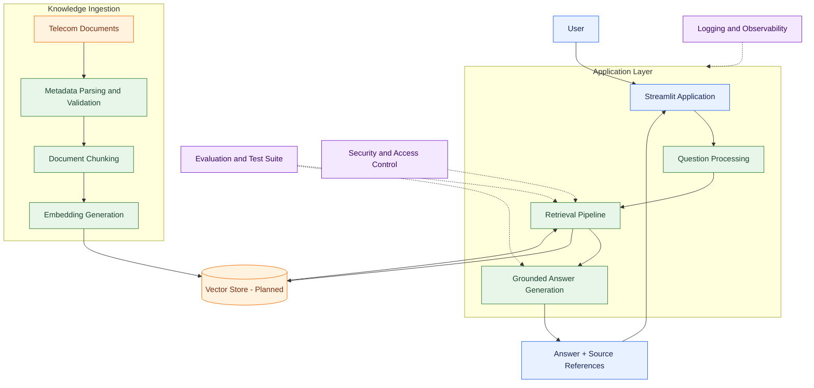

# Telco RAG — Telecom Knowledge Assistant

**A retrieval-augmented generation (RAG) platform for telecom knowledge, troubleshooting, product information, and service operations.**

[](https://www.python.org/)
[](https://streamlit.io/)
[](https://pytest.org/)
[](https://docs.astral.sh/ruff/)
[](LICENSE)

---

## Overview

`telco-rag` is a portfolio project exploring how to build a reliable, testable, and security-conscious RAG application for telecommunications.

Telecom organizations maintain knowledge across product catalogs, troubleshooting runbooks, network alarms, service-level agreements (SLAs), and operational documentation. Finding the right information quickly is challenging when knowledge is distributed across many documents.

This project builds a pipeline that ingests telecom documents, divides them into searchable chunks, converts those chunks into embeddings, retrieves relevant evidence, and uses that evidence to generate grounded answers.

The initial implementation uses synthetic telecom documentation. Database-backed retrieval, production APIs, evaluation, access control, and observability will be added incrementally.

## Objectives

- Build a reproducible document-ingestion pipeline.
- Preserve document provenance and metadata throughout processing.
- Implement chunking, embeddings, and semantic retrieval.
- Generate answers grounded in retrieved evidence.
- Measure retrieval quality and answer faithfulness.
- Enforce document-level access control.
- Add automated testing, structured logging, and observability.
- Provide an interactive Streamlit interface.
- Prepare a FastAPI service and PostgreSQL with pgvector for later stages.

## Architecture



*The diagram represents the target architecture. Components marked as planned are not necessarily implemented yet.*

## Technology stack

| Area | Technology | Purpose |
|---|---|---|
| Language | Python 3.12+ | Application and pipeline implementation |
| Environment and dependencies | uv | Reproducible Python development |
| User interface | Streamlit | Interactive knowledge assistant |
| Document format | Markdown + YAML front matter | Synthetic telecom knowledge corpus |
| Metadata parsing | PyYAML | Parse and validate document metadata |
| Testing | pytest | Unit and integration testing |
| Code quality | Ruff | Linting and formatting |
| Configuration | python-dotenv | Load local environment configuration |
| API | FastAPI — planned | Service interface |
| Vector storage | PostgreSQL + pgvector — planned | Vector similarity search and metadata filtering |
| Containers | Docker Compose — planned | Local service deployment |

## Repository structure

```text
telco-rag/
├── README.md
├── CONTRIBUTING.md
├── LICENSE
├── LOG.md
├── pyproject.toml
├── uv.lock
├── .env.example
├── .gitignore
├── docker-compose.yml
├── docs/
│   ├── architecture.md
│   ├── domain-model.md
│   ├── evaluation-strategy.md
│   ├── security.md
│   └── experiments.md
├── data/
│   └── synthetic/
│       ├── catalog/
│       ├── runbooks/
│       ├── alarms/
│       └── sla/
├── migrations/
├── src/
│   └── telco_rag/
│       ├── __init__.py
│       ├── config.py
│       ├── logging_config.py
│       ├── ingestion/
│       ├── chunking/
│       ├── embeddings/
│       ├── retrieval/
│       ├── generation/
│       ├── evaluation/
│       ├── security/
│       ├── observability/
│       └── api/
├── app/
│   ├── Home.py
│   └── pages/
│       ├── 1_Document_Ingestion.py
│       ├── 2_Knowledge_Search.py
│       ├── 3_RAG_Chat.py
│       ├── 4_Evaluation.py
│       └── 5_Experiment_History.py
└── tests/
    ├── unit/
    ├── integration/
    ├── retrieval/
    ├── evaluation/
    └── security/
```

This tree describes the intended repository organization. Some directories and application pages may be added as their corresponding stages are implemented.

## Getting started

### Prerequisites

- Python 3.12 or later
- [uv](https://docs.astral.sh/uv/)
- Git

### Installation

Clone the repository and enter its directory:

```bash
git clone <your-repository-url>
cd telco-rag
```

Install the project dependencies:

```bash
uv sync
```

If the ingestion or chunking dependencies have not yet been added to your environment, ensure the project declares PyYAML:

```bash
uv add pyyaml
```

Create your local environment file:

```bash
cp .env.example .env
```

Review `.env.example` and adjust settings as needed.

### Run the Streamlit application

```bash
uv run streamlit run app/Home.py
```

### Run tests

Run the full test suite:

```bash
uv run pytest
```

Run a specific test module:

```bash
uv run pytest tests/unit/test_ingestion.py -v
uv run pytest tests/unit/test_chunking.py -v
```

### Check code quality

```bash
uv run ruff check .
uv run ruff format --check .
```

If formatting changes are required, apply them with:

```bash
uv run ruff format .
```

**Current development note:** the chunking test module has an outstanding import error because `chunk_documents` is not currently exposed by `telco_rag.chunking`. Resolve this before treating the full test suite as passing.

## Knowledge corpus

The project starts with synthetic telecom documents covering six example use cases:

| Document | Type | Purpose |
|---|---|---|
| `CAT-FIBER-500` | Product catalog | Fiber 500 service information |
| `CAT-BIZ-1000` | Product catalog | Business internet product information |
| `RB-BB-001` | Troubleshooting runbook | Broadband connectivity troubleshooting |
| `RB-OPT-001` | Troubleshooting runbook | Optical signal loss investigation |
| `ALARM-LOS-001` | Network alarm | Loss-of-signal alarm information |
| `SLA-BIZ-001` | SLA documentation | Business internet service targets |

The documents use YAML front matter to capture fields such as:

- `document_id`
- `title`
- `document_type`
- `version`
- `status`
- `access_level`
- `source_type`
- `domain`

These documents are fictional examples for development and testing. They are not authoritative telecom product specifications, real customer records, or actual network operating procedures.

## Development roadmap

| Stage | Focus | Expected outcome |
|---|---|---|
| 1 | Project foundation | Package structure, configuration, tooling, and tests |
| 2 | Synthetic knowledge corpus | Telecom documents with validated metadata |
| 3 | Document ingestion | Parsing, validation, loading, and duplicate-ID detection |
| 4 | Document chunking | Overlapping chunks with source offsets and metadata |
| 5 | Embeddings | Convert chunks into numerical vector representations |
| 6 | Vector storage | Persist vectors and metadata in PostgreSQL with pgvector |
| 7 | Retrieval | Retrieve relevant evidence and apply access filters |
| 8 | Answer generation | Generate answers grounded in retrieved passages |
| 9 | Evaluation | Measure retrieval relevance, answer faithfulness, and quality |
| 10 | Security | Authorization, input validation, and prompt-injection defenses |
| 11 | Observability | Structured logs, latency, failure tracking, and tracing |
| 12 | API and UI integration | Connect the application to a FastAPI service |
| 13 | Deployment | Containerization, configuration management, and operational checks |

The roadmap is incremental. A stage is complete only when its implementation, tests, and documentation meet its acceptance criteria.

## Engineering principles

### Grounded generation

Answers should be based on retrieved evidence. When the corpus does not contain sufficient information, the application should communicate uncertainty instead of inventing telecom policies or operational facts.

### Provenance

Every chunk should retain its source document ID, source path, title, metadata, and offsets. This enables source attribution, debugging, and evaluation.

### Access control

Access metadata must be enforced by the retrieval and application layers. Merely storing an `access_level` field does not provide authorization. User identity and permissions must be validated before protected content is returned.

### Evaluation before optimization

Chunk sizes, overlap, embedding models, retrieval settings, and prompts should be compared using repeatable experiments rather than intuition alone.

### Reproducibility

Dependency changes should be managed through uv, behavior should be tested with pytest, and implementation decisions should be documented in `LOG.md` and `docs/experiments.md`.

## Configuration

Local environment variables belong in `.env`, which should not be committed to Git. Use `.env.example` to document supported configuration names without including secrets.

Do not commit API keys, credentials, real subscriber information, or production network data.

## Contributing

See [CONTRIBUTING.md](CONTRIBUTING.md) for development conventions, testing expectations, and contribution workflow.

## License

This project is distributed under the MIT License. See [LICENSE](LICENSE).

## Disclaimer

This is an educational and portfolio project. It is not a production telecom operations system. Synthetic data, experimental retrieval configurations, and generated answers must be validated before any real operational use.
